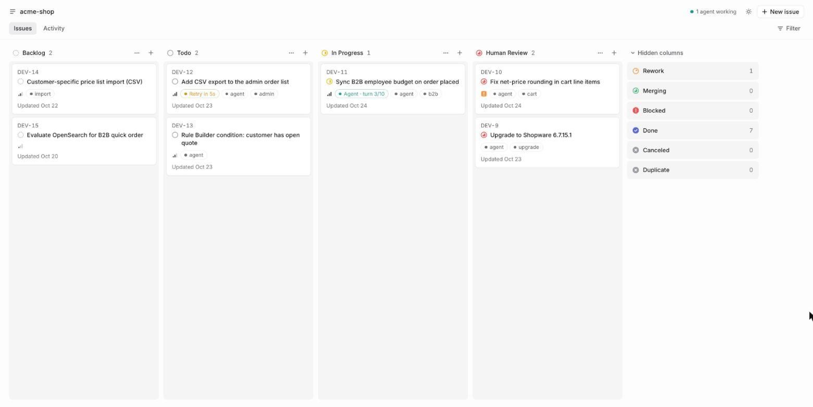
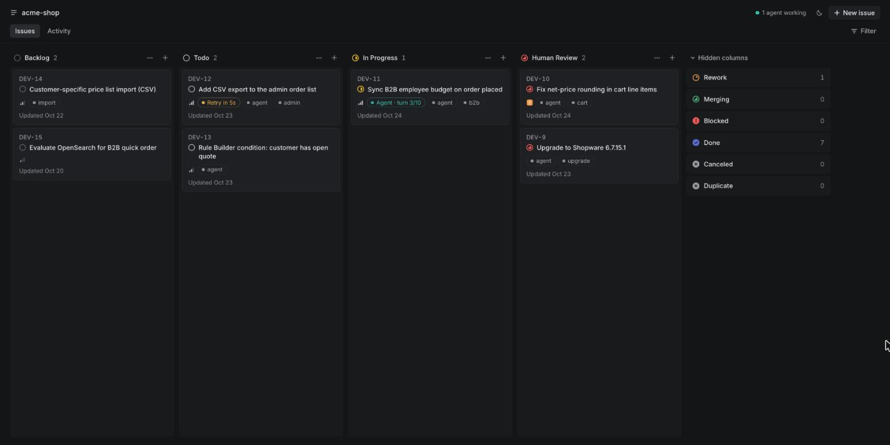
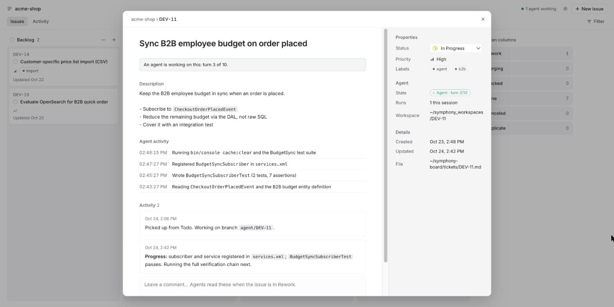
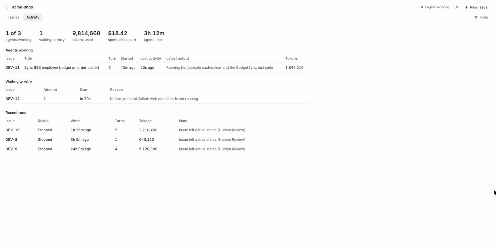

# Symphony (Claude Code + Codex)

An implementation of [openai/symphony `SPEC.md`](https://github.com/openai/symphony/blob/main/SPEC.md):
a daemon that polls a ticket board (local markdown files, or Jira), gives every eligible ticket its own workspace, and runs Claude Code or Codex
headless in it until the ticket leaves an active state (e.g. moves to `Human Review`).

Differences from the spec: agents run through CLI processes instead of Codex app-server. A turn is
one `claude -p --output-format stream-json` or `codex exec --json` invocation. Continuations resume
the same Claude session or the thread ID returned by Codex. SSH workers (Appendix A) are not implemented.



## Features

**Orchestration (SPEC core)**
- Polls the tracker, dispatches eligible tickets by priority and age, and respects `blocked_by`,
  `required_labels`, and global and per-state concurrency limits.
- Runs multi-turn Claude Code or Codex sessions. Turn 1 renders the Liquid prompt; later turns resume
  the same session with a continuation prompt. Choose the provider and model per ticket before Todo.
- Reconciles every tick. A ticket that leaves an active state stops its agent, and a silent agent
  is killed after `stall_timeout_ms`.
- Retries failures with exponential backoff, and continues 1 s after a clean exit if the ticket is
  still active.
- Optional handoff gate: with `checks.commands`, an agent's move to `Human Review` only sticks if Symphony's own
  checks pass (comment with the checked git sha). Otherwise the ticket goes back and the agent resumes with the failure.
- A ticket that uses up `max_turns` gets a comment and moves to `Blocked`, so it can't loop forever.
- Hot-reloads `WORKFLOW.md`. An invalid edit pauses new dispatch and keeps the last good config.

**Trackers**
- **Local**: one markdown file per ticket, with a YAML header and the body as description.
  There are no services to run.
- **Jira Cloud**: REST v3 with token paging, blockers from issue links, and ADF flattened to text.
- Agents update their own ticket through `$SYMPHONY_TRACKER comment|transition`, which is scoped to
  the dispatched key.

**Workspaces**
- Each ticket gets its own directory under `workspace.root`, with `after_create`, `before_run`,
  `after_run`, and `before_remove` hooks.
- `workspace.shared` mode runs every ticket in one existing checkout, such as a Docker-mounted
  Shopware project, one agent at a time.

**Dashboard** (local-only, no build)
- A Linear-style board with drag-and-drop moves, configurable and hidden columns, a filter,
  `c` for a new issue, and system, light, and dark themes.
- An issue view showing the description, live agent activity, comments, properties, and agent/model selection.
- An Activity tab with running agents, the retry queue, recent runs, tokens, cost, and agent time.
- A JSON API (SPEC 13.7). Writes are protected against cross-site requests and DNS rebinding.

**Footprint**: Node 24 runs the TypeScript directly with no build step. The only runtime
dependencies are `yaml` and `liquidjs`. Tests fake both CLIs (`test/fixtures/fake-{claude,codex}.mjs`).

## Initialize any project

Install this checkout once (Node 24+, Git and Bash; macOS/Linux):

```bash
npm install --global /absolute/path/to/symphony
cd ~/Sites/project1
symphony-linear init .
```

These are **end-user host commands**. Repository development commands still run in the isolated
container described in AGENTS.md. Nothing is published to npm; install from the local checkout
or a package produced with `npm pack`. The packaged launcher strips this package's TypeScript,
so global installation works without a build step.

`init` requires the Git project root with at least one commit. It creates a local markdown board,
adds `/.symphony-linear/` to the root `.gitignore`, starts a background instance, and prints its
localhost dashboard URL. Each project has its own instance and an OS-assigned free port.
The port can change after restarting. Repeating `init` preserves configuration and tickets and
returns the running instance's URL. It does not open a browser or start at login.

```bash
symphony-linear status .
symphony-linear stop .
symphony-linear start .
# Choose the project's initial default base branch (required on detached HEAD):
symphony-linear init . --base-branch main
```

All project state lives here; the application itself remains in its installation directory:

```text
.symphony-linear/
  WORKFLOW.md       # editable workflow, project base branch, provider defaults
  tickets/          # local board
  worktrees/        # isolated ticket checkouts
  worktree-state/   # original base commit and ticket branch; retained for rework
  logs/daemon.log   # append-only daemon output
  runtime.json     # current instance address and private control token
```

Git keeps its own worktree administration in the repository's Git directory. Initialization also
uses a temporary lock there; daemon and lifecycle locks live in `.symphony-linear/`.
The ignore rule prevents ordinary staging, not `git add -f`. Initialization refuses already
tracked state and does not untrack it automatically. Commit the `.gitignore` change if you want
other checkouts to inherit it. Back up local tickets separately; Git does not back them up.

Create tickets in **Backlog**, choose their coding agent and **Base branch**, then move them to
**To Do** when ready. Claude is the default; tickets can select Codex and a model. Both CLIs must
be installed and authenticated as the user running Symphony. Only tickets with the agent label
are dispatched. One agent runs per project by default; different projects run independently.

The base selector lists local and already fetched remote-tracking branches. It does not fetch.
`workspace.base_branch` supplies the default, initially the branch checked out during `init`.
The selected branch is resolved when the ticket first starts; uncommitted project changes are
not copied. Each ticket gets a `symphony/DEV-N` branch. The base choice locks at creation, and
retries/rework reuse that ticket's branch and checkout without resetting or rebasing it.
Missing bases and existing unrelated ticket branches fail explicitly. After cleanup, a deleted
ticket branch must be restored before rework can resume.

Agents commit locally and hand off to **Human Review**; there is no automatic push or merge.
Review or merge the ticket branch yourself. Terminal-state cleanup uses `git worktree remove`
without force, preserving dirty/untracked work and keeping the branch. Configure project-specific
setup in `hooks.after_create` and checks in `checks.commands`; initialization does not install
project dependencies or infer test commands. Git worktrees share Git metadata and are not
security sandboxes.

For project worktrees, Codex receives additional writable roots for the ticket directory and
shared Git metadata using its [workspace-write settings](https://learn.chatgpt.com/docs/config-file/config-reference).
It retains the configured sandbox and approval policy. This permits shared ticket/Git writes;
it does not enable network or Docker access. Organization policies may further restrict these
permissions. Existing standalone workflows retain their previous sandbox behavior.

`stop` authenticates the instance before requesting graceful shutdown; it never kills a PID
from a stale file. If a recorded PID is alive but the instance is unresponsive, inspect the log
and that process before removing stale runtime metadata. Stopping keeps all tickets and worktrees.

The original `symphony path/to/WORKFLOW.md --port N` foreground interface remains available,
including local and Jira workflows. “Linear” here names the local board, not a Linear integration.

## Run

Local board, no external services:

```bash
mkdir -p ~/symphony-board/tickets
cp WORKFLOW.example.md ~/symphony-board/WORKFLOW.md    # set the clone path in after_create
cat > ~/symphony-board/tickets/DEV-1.md <<'EOF'
---
state: To Do
title: Add a health-check endpoint
labels: [agent]
---
Return 200 with {"ok": true} on GET /health. Add a test.
EOF
node src/cli.ts ~/symphony-board/WORKFLOW.md
```

The agent clones your local repo, works on `agent/DEV-1`, pushes the branch back, comments on the
ticket file, and sets `state: Human Review`. To send it back, set `state: Rework`; to clean its
workspace, set `state: Done`. For Jira, start from `WORKFLOW.jira.example.md`.

Needs Node ≥ 24 (TypeScript runs via native type stripping, no build), the selected agent CLI (`claude`
or `codex`) installed and authenticated, and the Git tools your workflow uses. Authenticate each CLI
as the user running Symphony; Codex reuses its saved CLI login. Logs are JSON lines on stdout;
`SYMPHONY_LOG_LEVEL=debug` adds every agent event.
`WORKFLOW.md` is re-read on change. An invalid edit pauses dispatch and keeps the last good config.

## Dashboard

Set `server.port` in WORKFLOW.md (the local example uses `4555`) or pass `--port 4555`, then open
<http://127.0.0.1:4555/>.

- **Board**: one column per state in `board.columns`. The default is the active states,
  `Human Review`, the blocked state, then the terminal states.
  - `board.hidden_columns` collapse into a side list that shows counts and accepts drops. Click one
    to show it, and use a column's ⋯ menu to hide it again. These choices are saved per browser.
  - Drag a card to change its state.
  - Use **New issue**, a column's **+**, or `c` to create a ticket (local tracker only).
    "Let an agent pick this up" adds `required_labels`.
  - Cards show priority, labels, and an agent chip: the turn while it runs, or the retry countdown.

  

- **Issue view**: click a card to see the description, live agent activity, the comment thread,
  and a comment box. The sidebar has status, priority, labels, the agent state, the workspace,
  and the ticket file. Esc, ×, or a backdrop click closes it.

  

- **Activity**: running agents, the retry queue, recent runs, and token, cost, and agent-time totals.

  

Screenshots use demo data.

Board writes (`POST /api/v1/tickets`, `/api/v1/tickets/<id>/state`, `/api/v1/tickets/<id>/comments`)
require `Content-Type: application/json` and a same-origin `Origin`, so another website you visit
can't create work for an unattended agent. It binds to 127.0.0.1 only and rejects non-local `Host` headers. JSON API (SPEC 13.7):
`GET /api/v1/state`, `GET /api/v1/<ticket>`, `POST /api/v1/refresh` (poll now). Changing the port
needs a restart.

Development: follow `AGENTS.md` for a separate worktree and container; run tests and typecheck there.

## Choose an agent before Todo

Create a ticket in Backlog (or another configured inactive state), choose **Coding agent** and an
optional **Model**, then create it. On an existing ticket, open **Agent**, choose Claude or Codex,
enter or pick a model, and click **Save agent** before changing its status to Todo. Status changes
are disabled while that form has unsaved edits. Clearing Model uses that provider's configured default.
The **Default** provider option follows `agent.provider`.

Existing workflows and tickets keep using Claude unless you change the workflow default:

```yaml
agent:
  provider: claude
claude:
  model: opus
codex:
  command: codex
  model: gpt-6.1-sol
  sandbox: workspace-write
```

The provider, model, and agent timeouts are fixed for each running attempt. Changing a ticket or
reloading the workflow affects the next attempt; continuation turns keep the existing session.
There is no automatic fallback to the other provider. Model suggestions do not verify account access.
Both providers share concurrency limits, workspaces, tracker tools, and handoff checks.

Local tickets store `agent_provider: codex` and optional `agent_model: gpt-6-astra` in the YAML header.
Jira tickets use reserved labels `symphony:agent:codex` and optional `symphony:model:gpt-6-astra`;
the dashboard updates those labels while preserving unrelated labels. Use one provider label and
at most one model label; invalid or conflicting selections are rejected when reading tickets.

The Activity tab and API show the actual provider/model for running and recent attempts. Codex
reports token usage without a billed USD total, so total spend becomes **Unknown** (`cost_usd: null`)
after a Codex turn, rather than showing an incomplete total as zero.

## Front matter (beyond the spec's core keys)

| key | default | notes |
|---|---|---|
| `board.columns` / `board.hidden_columns` / `board.title` | active states, `Human Review`, blocked, terminal / `[]` / board dir name | Linear-style board: visible columns, the collapsible "Hidden columns" list (counts, drop targets, click to show), and the header title |
| `workspace.shared` | — | run every ticket in this existing directory (e.g. a Docker-mounted project checkout) instead of per-ticket workspaces; never created or deleted, forces `max_concurrent_agents` to 1 (deviation from SPEC 9) |
| `agent.blocked_state` | `Blocked` | ticket that used all `max_turns` while still active gets a comment and moves here instead of being re-dispatched (deviation from SPEC 7.1); if that move fails it is skipped until its state changes |
| `agent.provider` | `claude` | default provider when a ticket has no explicit choice; `claude` or `codex` |
| `checks.commands` | `[]` | run in order in the workspace (via `bash -lc`) when an agent moves a ticket to `checks.handoff_state`; none = no gate. The first failure moves the ticket back with the output and resumes the agent (counts toward `max_turns`) |
| `checks.handoff_state` | `Human Review` | the gated state; must not be an active or terminal state. Only agent moves are gated, not a human dragging a card |
| `checks.timeout_ms` | `600000` | per command; stall detection is paused while checks run |
| `claude.command` | `claude` | launched via `bash -lc` in the workspace |
| `claude.model` | — | passed as `--model` |
| `claude.permission_mode` | `bypassPermissions` | passed as `--permission-mode` |
| `claude.allowed_tools` | `[]` | passed as `--allowedTools` |
| `claude.turn_timeout_ms` | `3600000` | |
| `claude.stall_timeout_ms` | `300000` | `<= 0` disables; no events during a long Bash call count as a stall |
| `codex.command` | `codex` | CLI command or wrapper, launched via `bash -lc` |
| `codex.model` | `gpt-6.1-sol` | default model; tickets can override it |
| `codex.sandbox` | `workspace-write` | `read-only`, `workspace-write`, or `danger-full-access`; approval policy is always `never` for unattended runs |
| `codex.turn_timeout_ms` | `3600000` | |
| `codex.stall_timeout_ms` | `300000` | `<= 0` disables |

Hooks and the agent get `SYMPHONY_ISSUE_IDENTIFIER` and `SYMPHONY_WORKSPACE`. The agent also gets
`SYMPHONY_ISSUE_ID`, `SYMPHONY_WORKFLOW`, and `SYMPHONY_TRACKER`.

## Local adapter profile (SPEC 11.2)

- **kind:** `local`. **provider keys:** `dir` (default `tickets`, relative to WORKFLOW.md, `~`/`$VAR` ok),
  `prefix` (default `DEV`; the board creates `<prefix>-<next number>.md`). No secrets.
- **default states:** active `To Do`, `In Progress`; terminal `Done`.
- **scope:** every `*.md` in `dir` except `README.md`. Filename without `.md` = `id` = `identifier`
  (must match `[A-Za-z0-9._-]+`). `native_ref` = `{path}`; `url` = `file://` URL.
- **header fields:** `state` (required), `title` (or the first `# heading`), `priority` (int),
  `labels`, `blocked_by` (ticket ids), `assignee`, `branch`, `created` (else file birth time),
  `agent_provider` (optional `claude`/`codex`), and `agent_model` (optional; requires an explicit provider).
  The body (including `## Comments`) is the description.
- **dispatchable:** every `blocked_by` ticket exists and is in a terminal state.
- **malformed:** missing state/title or bad YAML → skipped with a warning when listing; fails ID refresh.
- **agent tools:** `transition` rewrites `state:` (keeps your YAML comments); `comment` appends a
  timestamped entry under `## Comments`. Writes are atomic (temp file + rename).

## Jira adapter profile (SPEC 11.2)

- **kind:** `jira`, Jira Cloud REST v3, basic auth (email + API token).
- **provider keys:** `base_url` (required, http(s), env fallback `JIRA_BASE_URL`), `project` (required
  project key), `jql` (optional, ANDed onto the scope), `email` / `api_token` (secrets, accept
  `$VAR`, env fallback `JIRA_EMAIL` / `JIRA_API_TOKEN`; empty = missing).
- **default states:** active `To Do`, `In Progress`; terminal `Done`.
- **scope & paging:** `project = "<project>" [AND (<jql>)]` via `POST /rest/api/3/search/jql`, 100 per
  page with `nextPageToken`, up to 100 pages (more → `tracker_pagination`). ID refresh uses
  `id in (...)` in chunks of 100. If Jira rejects that list because an id is gone (HTTP 400), it falls
  back to one query per id and leaves out the missing ones.
- **mapping:** `id` = numeric issue id; `identifier` = issue key; `native_ref` = `{key, project}`;
  `priority` Highest/High/Medium/Low → 1–4, otherwise null; `description` is ADF flattened to text;
  `labels` are lowercased and de-duplicated; `blocked_by` = links whose inward description contains
  "blocked by"; `branch_name` = null.
- **dispatchable:** true when every blocker is in a terminal state.
- **malformed:** records missing id/key/summary/status are skipped (and logged) in state queries.
  They fail ID refresh with `tracker_response`.
- **errors:** `TrackerError.category` is one of `invalid_tracker_config`, `missing_tracker_secret`,
  `unsupported_tracker_kind`, `tracker_request`, `tracker_status`, `tracker_response`,
  `tracker_pagination`, or `tracker_rate_limited`. The message is human-readable.
- **agent tools:** `$SYMPHONY_TRACKER comment <KEY> [text|-]` and
  `$SYMPHONY_TRACKER transition <KEY> <state>`, which matches the target status name or the transition
  name. Both refuse any key other than the dispatched issue.

## Trust posture

This targets **trusted environments**, like upstream. Claude defaults to `bypassPermissions`, because
an unattended run can't answer permission prompts. Claude can run anything your user can, with your
CLI login, git and `gh` credentials, and Docker socket. Its per-ticket directory is not a security boundary.

Codex defaults to `workspace-write` with `approval_policy="never"`. This permits workspace edits but
does not automatically grant writes to an external local board or Git remote, network access, or
Docker access. Configure a wrapper in `codex.command` with the required Codex settings and write roots,
or explicitly select `codex.sandbox: danger-full-access` only in a trusted, isolated runner where broader
access is intended. Before using a real board, verify the selected CLI can run the project's commands,
push its branch, and call `$SYMPHONY_TRACKER` from that runner. A Codex workspace must be a Git repository
unless its command wrapper explicitly opts out of the Git check.

Shortcut (Jira only): the agent inherits the host environment, `JIRA_API_TOKEN` included, because the
`$SYMPHONY_TRACKER` tool runs as the agent's child. To keep the token away from the agent, move the
tools behind a local socket owned by the orchestrator.

Use `required_labels` to choose which tickets get picked up, and keep `max_concurrent_agents` low
until you trust the prompt.
